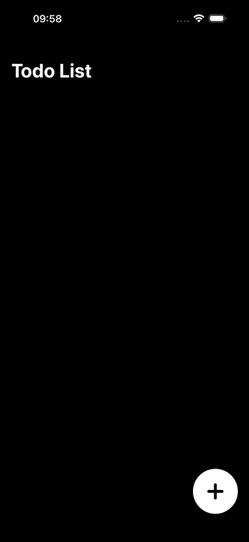

# To-Do with On-Device AI

A SwiftUI to-do app that turns a goal into a task list with Apple's on-device language model,
through the Foundation Models framework. The tasks stream into the list while the model writes
them, SwiftData saves them, and a home-screen widget checks them off.

  

The prompt is “Prepare for a job interview”. The model runs on the device: no server and no API
key. [Full-quality video](docs/demo.mp4).

## How the AI part works

The code is in [`AI/`](ProductivityWidgets/ProductivityWidgets/AI) and
[`TodoViewModel.swift`](ProductivityWidgets/ProductivityWidgets/Presentation/Todo/TodoViewModel.swift).

- **One session with fixed instructions.** `AISessionManager` creates a `LanguageModelSession`
  whose `Instructions` make the model a planner that answers only with short, actionable tasks.
  The user's text goes only into the prompt. The model is trained to follow instructions over
  prompts, which helps against prompt injection.
- **Guided generation.** `GenerableTask` is a `@Generable` struct with a `@Guide`, so the model
  returns a typed array of tasks instead of free text to parse. Greedy sampling keeps the output
  steady for the same goal.
- **Streaming.** `streamResponse(to:generating:options:)` yields snapshots of a partially
  generated `GenerableTask`. Each snapshot replaces an in-memory list that SwiftUI draws with an
  animated gradient, so the list seems to write itself.
- **One save at the end.** When the stream finishes, a single `ModelContext.transaction` inserts
  every task, and the widget reloads once.
- **Prewarming.** The session is prewarmed when the list and the add-task sheet appear, so the
  model is loaded before the user asks.

[`FoundationModelsPlayground.swift`](ProductivityWidgets/ProductivityWidgets/AI/FoundationModelsPlayground.swift)
is an Xcode `#Playground` that tries guided generation with nested `@Generable` types and a
`.count(3)` guide.

## The widget

The home-screen widget reads the same SwiftData store through an App Group and checks a task off
in place with an App Intent,
[`ToggleTodoTask`](ProductivityWidgets/TodoWidget/AppIntent.swift).

https://github.com/user-attachments/assets/33d33c0a-aaaf-4cba-9650-5504d1e699e8

## Run it

- Xcode 26 or later. The app and the widget target iOS 26. Last built with Xcode 27.1.
- Apple Intelligence must be on, on the iPhone or on the Mac that runs the Simulator. Without it
  the model isn't available and generation fails.
- Pick your team under Signing & Capabilities for both targets, and replace the App Group
  `group.GabrielEirado.widgets` in both entitlements files with one of yours.

## Article

[Foundation Model Framework: Essentials Deep Dive](https://medium.com/@Eirado/foundation-model-framework-essentials-deep-dive-736483c8f026)
covers sessions, instructions and prompts, streaming and guided generation, and uses this app as
its example of streaming generation.

## Stack

Swift, SwiftUI, SwiftData, Foundation Models, WidgetKit, App Intents, Swift Concurrency.
